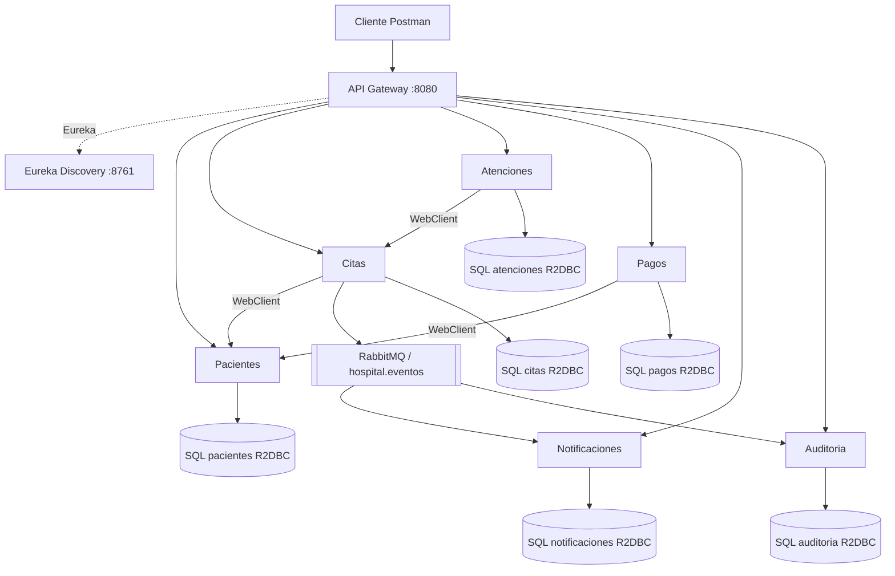

# Documento técnico — Hospital Vida Salud

## 1. Problema y objetivo

El Hospital Vida Salud usa una solución monolítica ficticia que concentra pacientes, citas y procesos administrativos. Su crecimiento ocasiona congestión, acoplamiento, duplicación y riesgo al desplegar una nueva versión. El objetivo de la evaluación T2 es implementar un flujo administrativo distribuido, con punto de entrada único, descubrimiento, intercambio síncrono y asíncrono, persistencia SQL reactiva y pruebas continuas.

El sistema es **exclusivamente académico**. Nunca utiliza diagnósticos, historias clínicas, resultados clínicos reales ni datos personales auténticos.

## 2. Actores y alcance

Actores identificados en el caso: paciente; personal de admisión; personal de salud; laboratorio; farmacia; caja/administración; administrador del sistema; equipo de desarrollo.

Flujo **implementado**:

1. Admisión registra paciente ficticio y lo consulta.
2. Se verifica que el documento no exista (restricción SQL y aplicación).
3. Se programa una cita futura; Citas consulta a Pacientes en tiempo real mediante WebClient/Eureka.
4. Se confirma la cita, con transición controlada.
5. Citas publica el evento `CitaConfirmada` en RabbitMQ.
6. Notificaciones y Auditoría consumen el evento y guardan evidencia en bases independientes.
7. Se registra una atención administrativa asociada a la cita confirmada.
8. Caja puede registrar un pago simulado con un monto válido, referencia de paciente y operación única.
9. Maven prueba el código y GitHub Actions repite la verificación en cada push/PR.

No implementado: Hospitalización, Farmacia, Laboratorio y facturación avanzada. El enunciado permite distintos niveles de profundidad y presenta Laboratorio como opcional en el flujo funcional mínimo; se decidió no crear microservicios artificiales. **Pagos sí se implementa** porque la lista de pruebas automatizadas exige rechazar monto cero o negativo.

## 3. Responsabilidades y propiedad de datos

| Servicio | Puerto | Base propia | Entidad principal | Operaciones | Dependencia / eventos |
|---|---:|---|---|---|---|
| Eureka Server | 8761 | Ninguna | Registro de instancias | Registro y descubrimiento | Los otros clientes se registran |
| Gateway | 8080 | Ninguna | Rutas | Proxy `/api/**` a `lb://` | Eureka |
| Pacientes | 8081 | `hospital_pacientes` | `pacientes` | Alta, consulta, actualización, activación | Provee contrato a Citas/Pagos |
| Citas | 8082 | `hospital_citas` | `citas` | Alta, consulta, transiciones | Consulta Pacientes; publica eventos |
| Atenciones | 8083 | `hospital_atenciones` | `atenciones` | Alta y consulta | Consulta Citas |
| Pagos | 8084 | `hospital_pagos` | `pagos` | Alta y consulta | Consulta Pacientes |
| Notificaciones | 8085 | `hospital_notificaciones` | `notificaciones` | Consume y consulta | Cola RabbitMQ `notificaciones.citas` |
| Auditoría | 8086 | `hospital_auditoria` | `auditoria_eventos` | Consume y consulta | Cola RabbitMQ `auditoria.citas` |

Cada servicio solo lee/escribe sus tablas. Los campos `paciente_id` y `cita_id` son referencias lógicas, **no claves foráneas entre bases**. Su validez se consulta por HTTP, no haciendo joins entre servicios.

## 4. Arquitectura

### 4.1. Diagrama de componentes



Archivos completos editables: `arquitectura.mmd` y `flujo.mmd`.

### 4.2. Gateway

El Gateway recibe peticiones externas por el puerto 8080. Usa el nombre lógico anunciado en Eureka mediante rutas `lb://PACIENTES-SERVICE`, `lb://CITAS-SERVICE`, etc. Esto evita fijar IP y puertos de instancias en el cliente. El balanceo de carga corresponde a Spring Cloud LoadBalancer.

### 4.3. Eureka

El panel `localhost:8761` muestra el registro de instancias; los servicios anuncian su nombre mediante `spring.application.name`. Al arrancar, Gateway y servicios clientes descubren sus destinos por el registro Eureka. No se utiliza Eureka como proxy del tráfico HTTP: es un registro de descubrimiento.

## 5. Modelo relacional

Scripts y restricciones en `../database/`. Cada base PostgreSQL incluye únicamente sus propios datos.

- **pacientes**: PK `id UUID`, `tipo_documento`, `numero_documento` (UK compuesto), nombres, apellidos, fecha nacimiento, teléfono, correo, dirección, fecha de registro y estado (`ACTIVO`/`INACTIVO`). Índice por apellidos.
- **citas**: PK `id UUID`, `paciente_id UUID` lógico, especialidad, `fecha_hora` UTC, `profesional_codigo`, motivo administrativo, estado y fechas. **Índice único parcial** `(profesional_codigo, fecha_hora)` para citas no canceladas y no ausentes. Índice de paciente.
- **atenciones**: PK `id UUID`, `paciente_id`, `cita_id` (única dentro de su propia base), fecha, área y estado `REGISTRADA`.
- **pagos**: PK `id UUID`, `paciente_id`, concepto, `monto NUMERIC(12,2) CHECK (monto > 0)`, fecha, medio, número de operación (único), estado.
- **notificaciones**: PK UUID, `evento_id` único para idempotencia, `recurso_id`, tipo, mensaje y fecha.
- **auditoria_eventos**: PK UUID, `evento_id` único, `recurso_id`, tipo, estado anterior/nuevo, origen y fecha.

No se utilizan JPA ni JDBC. Todos los repositorios de negocio implementan `ReactiveCrudRepository` para búsquedas y actualizaciones, y se utiliza `R2dbcEntityTemplate.insert` para insertar entidades con UUID generado por Java. Todo el acceso utiliza el driver `r2dbc-postgresql`.

## 6. Contratos REST y reglas

### Pacientes

**POST `/api/pacientes`**:

```json
{
  "tipoDocumento": "DNI", "numeroDocumento": "FICT-123456",
  "nombres": "Paciente", "apellidos": "Demostracion",
  "fechaNacimiento": "2000-01-15", "telefono": "900000000",
  "correo": "demo@example.test", "direccion": "Direccion ficticia"
}
```

Respuesta `201 Created`, con `id`, estado `ACTIVO` y fecha de registro. También `GET /api/pacientes`, `GET /api/pacientes/{id}`, `PUT /api/pacientes/{id}` y `PATCH /api/pacientes/{id}/estado` con `{"estado":"INACTIVO"}`. Duplicidad del par `(tipoDocumento,numeroDocumento)` produce `409 Conflict`; falta de campos o fecha futura produce `400 Bad Request`; ID inexistente `404 Not Found`.

### Citas

**POST `/api/citas`**:

```json
{
  "pacienteId": "REEMPLAZAR_UUID_PACIENTE",
  "especialidad": "Consulta administrativa",
  "fechaHora": "2026-12-15T15:00:00",
  "profesionalCodigo": "AG-001",
  "motivoAdministrativo": "Programacion ficticia"
}
```

Se usa tiempo UTC. Paciente debe existir y estar ACTIVO (consulta síncrona). No puede haber otra cita que bloquee el mismo profesional y horario. Respuesta `201` con `PENDIENTE`. Rechazo por agenda ocupada `409`, paciente inexistente/inactivo `422`, paciente fuera de servicio `503`. `GET /api/citas/{id}` devuelve `404` si no existe.

**PATCH `/api/citas/{id}/estado`**: `{"estado":"CONFIRMADA"}`.

| Estado actual | Destinos permitidos |
|---|---|
| `PENDIENTE` | `CONFIRMADA`, `CANCELADA` |
| `CONFIRMADA` | `ATENDIDA`, `AUSENTE`, `CANCELADA` |
| `ATENDIDA`, `AUSENTE`, `CANCELADA` | Ninguno (terminal) |

El cambio inválido produce `409`; un nombre de estado desconocido `400`. No se confirma una cita pasada. Se registra fecha de actualización y, para cada transición correcta, se publica un evento de estado.

### Atenciones

**POST `/api/atenciones`**: `{"pacienteId":"UUID","citaId":"UUID","area":"Admisión simulada"}`. La cita debe existir, estar `CONFIRMADA` y pertenecer al mismo paciente. Se registra una sola atención por cita (`409` duplicado), estado `REGISTRADA`. No se almacenan historias clínicas.

### Pagos

**POST `/api/pagos`**: `{"pacienteId":"UUID","concepto":"Tramite ficticio","monto":25.50,"medioPago":"EFECTIVO","numeroOperacion":"OP-123"}`. El monto debe ser estrictamente positivo; el número de operación no puede repetirse. Medios aceptados: `EFECTIVO`, `TARJETA`, `TRANSFERENCIA`. No se procesan transacciones monetarias reales.

### Notificaciones y Auditoría

`GET /api/notificaciones` y `GET /api/auditoria` devuelven colecciones reactivas de registros de ejemplo. Ambas APIs son de solo consulta para los clientes; sus inserciones se originan en mensajes RabbitMQ.

## 7. Comunicación síncrona

Citas valida al paciente antes de crear cita: `GET http://pacientes-service/api/pacientes/{id}`; se resuelve por Eureka y WebClient con `@LoadBalanced`. El contrato mínimo recibido es `{id,estado}`. Timeout máximo `3 segundos`; respuesta `404` equivale a referencia inválida (`422` para el cliente de Citas); otros errores o indisponibilidad equivalen a `503`. Atenciones valida la cita por el mismo mecanismo, y Pagos consulta a Pacientes.

Se eligió síncrono porque una cita no debe crearse sin saber si el paciente existe; la respuesta se necesita dentro de la operación actual. Si el sistema de destino no responde, la operación se rechaza; no se crea silenciosamente una referencia inexistente.

## 8. Comunicación asíncrona y eventos

- **Productor:** Citas, al confirmar o cambiar de estado.
- **Exchange:** `hospital.eventos`, tipo **topic**, durable.
- **Routing keys:** `cita.confirmada` o `cita.actualizada`.
- **Cola de Notificaciones:** `notificaciones.citas`, durable, binding `cita.confirmada`.
- **Cola de Auditoría:** `auditoria.citas`, durable, binding `cita.*`.
- **Consumidores:** `NotificacionConsumidor` y `RegistroAuditoriaConsumidor`, con métodos `@RabbitListener` que devuelven `Mono<Void>` para completar asincrónicamente la persistencia R2DBC.

Contenido JSON orientativo:

```json
{
 "eventoId":"EV_UUID", "tipo":"CitaConfirmada", "recursoId":"CITA_UUID",
 "pacienteId":"PACIENTE_UUID", "estadoAnterior":"PENDIENTE",
 "estadoNuevo":"CONFIRMADA", "origen":"citas-service",
 "fecha":"2026-10-10T12:00:00"
}
```

`eventoId` es UUID en texto para idempotencia; las tablas destino lo indexan como único. RabbitMQ desacopla el ciclo administrativo de las dos acciones secundarias: Citas no necesita llamar directamente por HTTP a Notificaciones o Auditoría. El productor trabaja con una plantilla AMQP tradicional, que potencialmente bloquea, por lo que la operación se programa en `Schedulers.boundedElastic()` y no en los hilos del event loop de WebFlux.

**Limitación explícita:** el cambio de estado SQL y la publicación no forman una transacción distribuida. En producción se exigiría una tabla *outbox* y publicación con reintentos, además de DLQ y observabilidad; no son requisitos mínimos de T2.

## 9. Programación reactiva

Controladores REST exponen `Mono<T>` al obtener o modificar una entidad y `Flux<T>` al listar. Los servicios encadenan `flatMap`, `then`, `switchIfEmpty`, `onErrorMap` y `timeout`; los repositorios y `R2dbcEntityTemplate` usan Spring Data R2DBC en lugar de `JpaRepository`. No hay llamadas `.block()` en el hilo HTTP. Los listeners devuelven resultados asíncronos `Mono<Void>` y la publicación AMQP se aísla en `boundedElastic`.

## 10. Seguridad y privacidad

Los datos de demostración son ficticios. Las contraseñas se inyectan con `DB_PASSWORD` y `RABBIT_PASSWORD` desde el entorno, y `.env*` se ignoran en Git. El Gateway no incluye autenticación: es una **limitación de seguridad conocida** para ejecución solo local; un escenario productivo requeriría OAuth2/JWT, autorización por actor, TLS, filtrado de PII en logs y segregación de permisos SQL. No se deben usar nombres, documentos o datos sanitarios reales.

## 11. Pruebas automatizadas

Tests con JUnit 5, Mockito, Reactor Test/StepVerifier y WebTestClient, ejecutables sin brokers ni bases reales:

| Caso | Test | Resultado esperado |
|---|---|---|
| Alta válida de paciente | `PacienteServicioTest` | `ACTIVO` |
| Paciente duplicado | `PacienteServicioTest` | HTTP 409 |
| Recurso inexistente | `PacienteServicioTest` | HTTP 404 |
| Controlador REST de pacientes | `PacienteControladorTest` | HTTP 201 y cuerpo |
| Cita para paciente válido | `CitaServicioTest` | `PENDIENTE` |
| No confirmar cita cancelada | `CitaServicioTest` | HTTP 409 |
| Confirmar y disparar evento | `CitaServicioTest` | `CONFIRMADA` |
| Publicar en exchange Rabbit | `CitaEventosTest` | Clave `cita.confirmada` |
| Monto cero/negativo | `PagoServicioTest` | HTTP 400 |
| Operación de pago duplicada | `PagoServicioTest` | HTTP 409 |
| Consumir aviso | `NotificacionConsumidorTest` | Registro ficticio |
| Consumir auditoría | `RegistroAuditoriaConsumidorTest` | Registro de transición |

Ejecución: `mvn --batch-mode --no-transfer-progress verify` en la raíz. Las pruebas de mensajería simulan el broker; la **demostración manual adicional** verifica el transporte real RabbitMQ y la persistencia real SQL.

## 12. Integración continua

Workflow `.github/workflows/ci.yml` con disparadores `push` y `pull_request` hacia `main`. Pasos: `actions/checkout@v4`, `actions/setup-java@v4` (Temurin JDK 21, caché Maven), `mvn --batch-mode --no-transfer-progress verify`. Maven reactor descubre y valida los ocho módulos. Cualquier compilación/prueba fallida provoca resultado rojo/no exitoso.

El estudiante debe crear una prueba intencionalmente incorrecta en una rama de trabajo, subirla, capturar el workflow rojo, restaurarla en otro commit y capturar el workflow verde. Si se activa una regla de protección de rama con CI requerido, no se pueden integrar cambios fallidos por Pull Request. **No** se configura despliegue automático ni se incluyen secretos en workflow.

## 13. Supuestos y limitaciones

- Un solo calendario por profesional ficticio y bloqueo por fecha-hora exacta; no se modelan turnos, duraciones variables ni zonas horarias de sedes.
- Todas las horas de citas se interpretan en UTC; los datos del script de demostración se generan a futuro.
- No se permite registrar atención administrativa excepcional sin cita; requiere cita confirmada.
- Una atención se registra máximo una vez por cita.
- Un pago puede representar un trámite administrativo, sin saldos/facturas ni pasarelas reales.
- No se implementa inventario ni pacientes reales.
- Registro de eventos de **transiciones de citas**; los demás módulos tienen reglas pero no están conectados a mensajería en este alcance.
- Para una implementación productiva faltarían control de acceso, outbox, DLQ, observabilidad, migraciones de esquema y protección de concurrencia optimista en todas las transiciones.

## 14. Procedimiento para demostrar

1. Ejecutar `mvn verify` y capturar pruebas.
2. Iniciar PostgreSQL, RabbitMQ y los ocho módulos siguiendo `../README.md`.
3. Abrir Eureka y capturar lista de aplicaciones.
4. Ejecutar `scripts/demo.ps1` por Gateway, capturar respuestas `201`, `409` y estado `CONFIRMADA`.
5. Consultar `SELECT * FROM citas` en la base `hospital_citas` y tablas de consumidores.
6. Capturar exchange y colas RabbitMQ (interfaz administrativa si está habilitada).
7. Hacer push y PR; capturar GitHub Actions verde.
8. En rama de trabajo, provocar prueba fallida, capturar rojo; corregir y capturar verde.
9. Entregar enlace público, README, documento técnico y evidencias legibles; defender la separación de responsabilidades y el uso reactivo.
